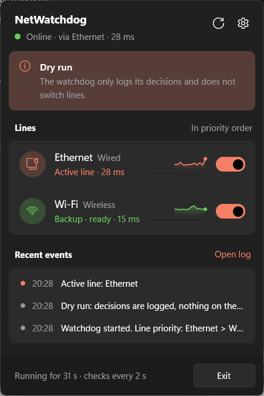
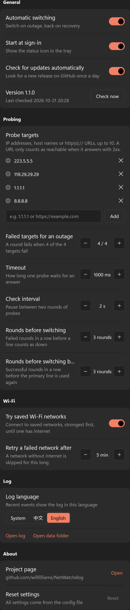
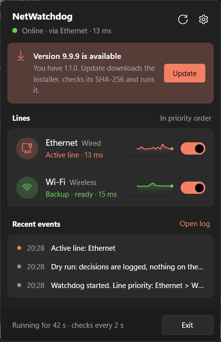
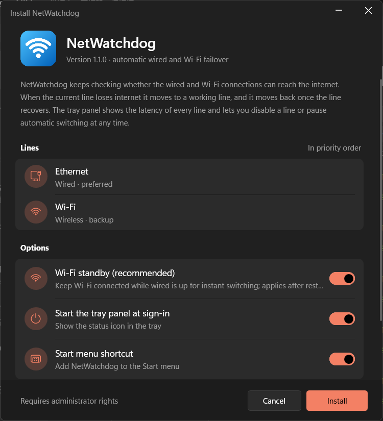
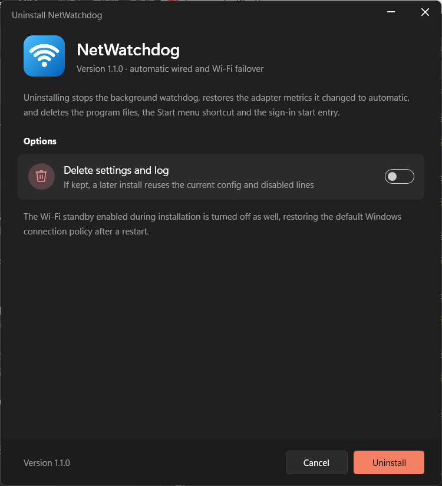

English | [简体中文](README.zh-CN.md)

# NetWatchdog

NetWatchdog is a network watchdog for Windows with two parts:

- The watchdog runs in the background, starts with Windows, and keeps pinging a few public addresses from every network adapter. When the primary line loses internet it moves traffic to a backup line, and it moves traffic back once the primary line recovers. When Wi-Fi is needed but has no working network, it connects to nearby saved Wi-Fi networks one by one, strongest signal first, until one really reaches the internet. A disabled adapter is re-enabled.
- The tray panel is a status icon in the notification area. Clicking it opens a Quick Settings style flyout that shows a latency chart for every line and lets you disable a line. A second-level settings page covers everything else: automatic switching, probe targets and thresholds, Wi-Fi behaviour, log language and update checks.

Both parts ship as one setup package, `NetWatchdog-Setup-<version>.exe`, which installs, upgrades and uninstalls like any other application. The tray panel checks GitHub Releases for new versions and can update itself. The UI and the log are available in English and Simplified Chinese. Everything runs on components that come with Windows: the watchdog is a PowerShell 5.1 script that calls `ping.exe` and `netsh`, and the tray panel and installer are compiled with the `csc.exe` compiler from .NET Framework 4.8. No .NET SDK, driver or third-party runtime is needed.



## How it works

### Probing

In every round the watchdog takes the IPv4 address of each configured adapter and probes the targets one after another from that address. A target is one of:

- an IP address or host name, probed with `ping -S <that address>`;
- an `http://` or `https://` URL, probed with an HTTP GET bound to that address. Only a 2xx answer counts; redirects are not followed, so a hotspot that redirects to a sign-in page counts as failed.

A round fails when `failTargets` of the targets fail; with 4 targets and `failTargets` 2, two failed targets make the round fail. Probing stops as soon as the outcome of the round is decided. The round-trip time of the successful targets becomes the line's latency.

Windows sends packets with the strong host model: when a source address is given, the packet leaves through the adapter that owns that address. So after traffic has moved to Wi-Fi, the watchdog can still probe through the wired adapter and see when it recovers.

For ping, a target counts as reachable when the output contains `TTL=`; the exit code of `ping.exe` is not used. When a gateway answers "Destination host unreachable", `ping.exe` still exits with 0, so relying on the exit code would report a dead line as healthy.

### Debouncing

A single lost packet never triggers a switch. Line states are updated by three rules:

1. The line in use is marked down after `failThreshold` failed probes in a row. A pulled cable or an adapter without an address marks the line down at once, because there is nothing to misjudge in that case.
2. A line ranked above the current active line needs `recoverThreshold` successful probes in a row before it counts as recovered. This rule stops flapping when the primary line keeps dropping in and out.
3. Every other line counts as up after one successful probe. That covers backup lines, and any line while nothing works. Once the primary line is gone, any working line beats none, so there is no reason to wait.

### Switching

The order of `interfaces` in the config is the priority. Among the lines that are not disabled, the watchdog picks the highest-priority line that is up as the active line, then raises the interface metric of two groups of lines to `demotedMetric` (9000 by default):

- lines ranked above the active line;
- lines disabled in the panel.

All other lines keep the automatic metric. Windows always prefers the default route with the lowest metric, so new connections go through the active line. After a switch the DNS cache is flushed so that addresses resolved over the dead line are not reused.

While the primary line is healthy every adapter keeps its Windows defaults, and the watchdog changes nothing. When restoring automatic metrics it only touches interfaces whose metric equals `demotedMetric`, so any metric you set by hand stays as it is. The actual adapter state is compared in every round, which also corrects re-plugged adapters and metrics changed by other programs.

### Bringing lines up

For lines ranked above the active line (all lines when nothing works) that are not disabled, the watchdog tries to bring the line up in two cases:

- the adapter has no address;
- nothing works at all and the Wi-Fi adapter is on a network without internet.

A disabled adapter is re-enabled. For a Wi-Fi adapter, networks are tried one by one until one really has internet:

1. Candidates: the configured `profiles` in that order if any; otherwise the nearby networks found by a scan that have a saved password, sorted by signal, strongest first. If the scan returns nothing (location permission can block scans for SYSTEM), the first 5 saved networks in saved order are used.
2. The network the adapter is on now, which has no internet, is left out of this round.
3. After each connection the watchdog first checks that the adapter is on that SSID with an address, then pings the targets from this adapter, up to 3 times. If they reply it stops; otherwise it moves to the next network.
4. A network that failed is not retried for `wifiRetryMinutes` minutes (5 by default).
5. If every network fails, the adapter reconnects to the network it was on before.

While this runs, the Wi-Fi row and the status line of the tray panel show "Trying "network" (2/5)".

The watchdog only connects to saved networks. An encrypted network that was never saved has no password to use. Open networks are mostly hotspots that need a browser sign-in before they reach the internet, and they do not encrypt traffic, so they are not tried.

Attempts on the same adapter are at least `reconnectCooldownSeconds` seconds apart.

## Tray panel

The interaction follows [TouchToggle](https://github.com/willlllliams/TouchToggle) and mimics Windows 11 Quick Settings:

- Left-click the tray icon and the flyout opens next to the taskbar with a short fade-and-slide animation; click outside it or press Esc to close it.
- The right-click menu offers Open panel, Open log and Exit.
- Colors follow the light or dark mode of the taskbar, toggles and highlights use the system accent color, and both are re-read every time the flyout opens.

The color of the tray icon shows the current state:

| Icon | State |
|---|---|
| Green with a check | The primary line is working |
| Amber with two arrows | The primary line is down and traffic is on a backup line |
| Red with a cross | No enabled line has internet |
| Gray with two bars | Automatic switching is paused |
| Gray with a dash | The watchdog is not running or not responding |

When the active line changes, the panel shows a system notification such as "Switched to a backup line" or "Back online".

The flyout has two pages.

The main page shows the current state:

1. Title and status line: the active line and its latency. The refresh button starts a new round at once; the gear button opens the settings page.
2. Lines: one row per line with its role (active, backup, no internet, not connected, disabled, or the Wi-Fi network being tried), a latency chart of recent rounds and a toggle. Red ticks on the chart mark rounds where the probe failed; hover over a row to see its address and packet loss. Turning a line's toggle off stops the watchdog from using it; turning off the wired line, for example, forces traffic onto Wi-Fi. The last enabled line cannot be turned off.
3. Recent events: the last 4 log entries, with a colored dot for the event kind.

The settings page opens with a short slide from the right and has five groups:

| Group | Settings |
|---|---|
| General | Automatic switching (off pauses switching and hands every line back to Windows routing), start at sign-in, check for updates automatically, current version with a Check now button |
| Probing | Probe targets (add or remove IP addresses, host names and URLs), how many failed targets make an outage, timeout, check interval, failed rounds before switching, successful rounds before switching back |
| Wi-Fi | Whether to try saved Wi-Fi networks on an outage, how long a network without internet is skipped |
| Log | Log language (system, Chinese, English), open the log, open the data folder |
| About | Project page, reset every setting changed in the panel back to the config file |



When the watchdog is not running or not responding, a banner appears at the top. If the background task is missing, Repair runs the installer kept in the install folder to register the task again; if the task is stuck, Restart restarts it. Both need UAC approval.

### How the panel talks to the watchdog

The watchdog runs as SYSTEM and the panel runs as a normal user. They exchange information through files in `C:\ProgramData\NetWatchdog`:

| File | Written by | Content |
|---|---|---|
| `status.json` | watchdog | Full state at the end of each round: active line, address and latency of every line, latency history of the last 120 rounds, the Wi-Fi network being tried, and the settings in effect |
| `queue\*.req` | panel | One request per file: `probe`, `pause`, `resume`, `enable <adapter>`, `disable <adapter>`, `set <setting> <JSON value>`, `reset` |
| `overrides.json` | watchdog | Changes made in the panel: disabled lines, whether switching is paused, and changed settings. Survives restarts |
| `watchdog.log` | watchdog | Run log |

Between rounds the watchdog checks the `queue` folder every 250 ms, carries out any request and starts a new round right away, so a change in the panel takes effect within a second. Settings changed in the panel are stored in `overrides.json` and layered over `config.json`; the config file itself is never rewritten, and Reset settings removes the layer again.

The installer gives this folder full control for SYSTEM and administrators and read-only access for other users, and grants Modify on the `queue` subfolder only to the user who was signed in during installation. Everyday use therefore needs no UAC prompt, and other users cannot send requests to the watchdog. The watchdog accepts only the requests above: adapter names must exist in the config, settings must be on the list in the configuration table and within their range, and requests older than 2 minutes, files larger than 4 KB and reparse points are discarded.

## Updates

The tray panel looks for new versions in the GitHub Releases of `willlllliams/NetWatchdog`: 30 seconds after it starts, then once a day, and whenever you click Check now. It reads the latest release through the GitHub API and compares its tag (`v1.2.0`) with its own version.



When a newer version exists, a banner and a notification appear. Update downloads `NetWatchdog-Setup-<version>.exe` from the release into `%TEMP%\NetWatchdog-update` and checks it before running anything:

- the file size must match the release asset;
- the SHA-256 must match the value GitHub publishes for the asset, or the `SHA-256:` line in the release notes.

A file that fails either check is deleted. A release without a SHA-256 cannot be installed from the panel; the banner then links to the release page instead. A verified installer is started and goes through the normal upgrade, which asks for UAC approval and keeps the config and log.

The installer is not code-signed, so Windows SmartScreen may warn the first time it runs. Automatic checks can be turned off on the settings page; the check only reads public release information and sends nothing but the request itself.

## Language

The tray panel and the installer follow the Windows display language: Simplified Chinese when the display language is Chinese, English for every other language. Start them with `--lang en` or `--lang zh` to choose. The language used during installation also sets the name shown in Installed apps and the name of the Start menu shortcut.

The log language of the watchdog comes from the `language` config setting. The installer writes the language it ran in, so the log matches the panel and the installer. When upgrading, an existing config keeps its value; only an untouched `auto` is replaced with the install language. With `auto` the watchdog follows the system default display language. It runs as SYSTEM, so it reads the system-wide setting, which can differ from your own display language: your account may prefer Chinese while the system default is English. Recent events in the panel show the log text as written, so their language follows this setting.

## Installation

Run `NetWatchdog-Setup-1.1.0.exe` and approve the UAC prompt to open the setup wizard:



The first page lists the detected lines and three options:

| Option | Default | Effect |
|---|---|---|
| Wi-Fi standby | On | Disables the group policy "Minimize the number of simultaneous connections to the Internet or a Windows Domain" (registry value `fMinimizeConnections=0`); takes effect after a restart |
| Start the tray panel at sign-in | On | Adds the panel to the signed-in user's own `Run` registry key |
| Start menu shortcut | On | Adds NetWatchdog to the Start menu |

I recommend keeping Wi-Fi standby on. By default Windows disconnects Wi-Fi while the wired connection is up. The watchdog works without this change, but every switch first has to connect Wi-Fi and wait for an address, which adds 5 to 15 seconds. With the change, Wi-Fi stays connected as a hot standby and a switch only changes one metric. The wired line has the lower metric, so traffic still uses it while it works.

After you click Install, the installer runs six steps and ticks them off on the progress page:

1. Stop the running version: end the scheduled task and every tray panel process.
2. Copy program files: copy the watchdog script, the tray panel and the installer itself to `C:\Program Files\NetWatchdog`, and give that folder full control for SYSTEM and administrators and read-only access for other users. The watchdog runs the script there as SYSTEM, so ordinary users must not be able to change it.
3. Prepare config and data folder: create `C:\ProgramData\NetWatchdog`, set its permissions, and grant Modify on the `queue` subfolder only to the signed-in user. Without a config file, `config.json` is generated from the detected adapters; an existing config is kept as it is.
4. Register the background task: a scheduled task named `NetWatchdog` that starts at boot, runs as SYSTEM, has no run-time limit, keeps running on battery and restarts every minute if it exits abnormally. It starts right after registration.
5. Apply system settings: Wi-Fi standby, sign-in start and the Start menu shortcut, as chosen.
6. Add to Installed apps: write the uninstall entry with name, version, publisher, icon, install location and size.

The final page can open the tray panel right away. The installer runs elevated, while the panel is started through Explorer and runs with the signed-in user's normal rights.

Every command the installer runs, with its output, is recorded in `%TEMP%\NetWatchdog-setup.log`. If a step fails, the final page shows the reason and a View setup log link. Completed steps are not rolled back; fix the problem and run the setup package again.

### Upgrade and repair

Running a newer setup package upgrades the installation. The wizard shows "Version x is installed and will be upgraded to y", keeps the install location and options, and preserves the config, disabled lines and log. Running the same version again reinstalls, which repairs the program files, folder permissions and background task.

When the tray panel finds that the background task is gone, the Repair button in its banner runs the installer from the install folder with `--repair`, which skips the first page and reinstalls with the existing settings.

### Command-line installation

The setup package accepts these arguments, which are useful for deployment:

| Argument | Effect |
|---|---|
| `--quiet` | No UI; uses the default options, or the existing ones when already installed. Exit code 0 means success |
| `--uninstall` | Uninstall; can be combined with `--quiet` |
| `--repair` | Reinstall right away with the existing settings |
| `--dir <path>` | Install location for a first installation |
| `--lang en`, `--lang zh` | UI language |

For example, a quiet installation from an elevated PowerShell:

```powershell
Start-Process .\NetWatchdog-Setup-1.1.0.exe -ArgumentList '--quiet' -Wait
```

## Building from source

Run the build script in the project folder:

```powershell
powershell -ExecutionPolicy Bypass -File .\build.ps1
```

The script calls `C:\Windows\Microsoft.NET\Framework64\v4.0.30319\csc.exe` and produces two files:

| File | Content |
|---|---|
| `bin\NetWatchdogUI.exe` | Tray panel |
| `bin\NetWatchdog-Setup-<version>.exe` | Setup package with the watchdog script and tray panel embedded |

The version number comes from the `VERSION` file and the repository checked for updates from the `REPOSITORY` file; both are compiled in. The first build generates the app icon `ui\app.ico`.

Source layout:

| Path | Content |
|---|---|
| `NetWatchdog.ps1` | Watchdog; English and Chinese log messages live in the `$Messages` table at the top |
| `ui\NetWatchdogUI.cs`, `ui\Flyout.xaml` | Tray panel with its main and settings pages |
| `ui\Updater.cs` | Update check, download and verification |
| `setup\Setup.cs`, `setup\Setup.xaml` | Installer |
| `ui\Shared.cs`, `ui\Styles.xaml` | Language selection, theme, styles and Win32 interop shared by the panel and the installer |
| `publish.ps1` | Publishes a GitHub release |
| `config.example.json` | Example config |

The tray panel and the installer are written in C# 5 with WPF; their layouts are XAML files embedded in the executables. UI text is written as English/Chinese pairs: `L.T("English", "中文")` in C# and `{local:Tr 'English', '中文'}` in XAML. Both languages sit in the same place, so editing one sentence cannot leave the other language behind.

### Publishing a release

Raise the number in `VERSION`, commit and push, then run:

```powershell
powershell -ExecutionPolicy Bypass -File .\publish.ps1 -Notes 'What changed'
```

The script builds the project, computes the SHA-256 of the setup package and uses the GitHub CLI (`gh`) to create the release `v<version>` with the setup package attached and the hash in the notes. Installed panels pick it up at their next check.

## Configuration

The config file is `C:\ProgramData\NetWatchdog\config.json`. Changing it requires administrator rights; saved changes take effect in the next round without restarting the task. If the new config has a syntax error, the watchdog logs it and keeps using the previous config. Most settings can also be changed on the settings page of the tray panel; those changes are layered over this file (see above).

| Setting | Default | Meaning |
|---|---|---|
| `interfaces` | detected at install | Adapters in priority order. `alias` is the adapter name (see `Get-NetAdapter`), `type` is `wired` or `wifi`, and `profiles` (Wi-Fi only) lists networks to try in that order |
| `targets` | `223.5.5.5`, `119.29.29.29`, `1.1.1.1`, `8.8.8.8` | Probe targets: IP addresses, host names or http(s):// URLs, up to 10 |
| `failTargets` | all targets | How many failed targets make a round fail. When absent, `minSuccess` is used instead |
| `minSuccess` | 1 | Older setting: how many targets must reply for the round to succeed. Ignored when `failTargets` is set |
| `intervalSeconds` | 5 | Interval between rounds |
| `pingTimeoutMs` | 1000 | Timeout of a single probe, ping or HTTP |
| `failThreshold` | 3 | Failed rounds in a row before a line is marked down |
| `recoverThreshold` | 3 | Successful rounds in a row before a higher-priority line counts as recovered |
| `reconnectCooldownSeconds` | 30 | Minimum time between two reconnect attempts on one adapter |
| `wifiHunt` | true | Try saved Wi-Fi networks one by one when nothing works |
| `wifiRetryMinutes` | 5 | Minutes before a Wi-Fi network that had no internet is tried again |
| `demotedMetric` | 9000 | Metric given to demoted lines |
| `flushDnsOnSwitch` | true | Flush the DNS cache when the active line changes |
| `statusEveryMinutes` | 60 | Minutes between status summaries in the log; 0 turns them off |
| `historySize` | 120 | Rounds of latency history kept in the status file |
| `language` | install language | Log language: `en`, `zh`, or `auto` to follow the system default display language |
| `logPath` | `C:\ProgramData\NetWatchdog\watchdog.log` | Log file |
| `statusPath` | `C:\ProgramData\NetWatchdog\status.json` | Status file; the request queue and `overrides.json` live in the same folder. The tray panel reads this location by default; if you change it, start the panel with `--status <path>` |
| `logMaxKB` | 1024 | The log is rotated to `.log.1` once it grows past this size |

I recommend mixing IP addresses with one URL that returns a fixed 2xx answer, such as `http://www.msftconnecttest.com/connecttest.txt`. IP addresses avoid DNS: with host names every probe first needs a DNS lookup, and when the DNS server itself is unreachable the lookup takes several seconds to time out, which slows the whole round and mixes DNS failures with line failures. A URL catches hotspots that let ping through but redirect web traffic to a sign-in page.

With the defaults, a switch completes about 30 seconds after the primary line loses internet. While the primary line is down, each round waits a full second for each of the 4 targets plus the 5-second interval, about 9 seconds per round, and 3 rounds take about 27 seconds. After the primary line recovers, 3 successful rounds of about 5 seconds each move traffic back, about 15 seconds. For faster switching, lower `failThreshold` or `pingTimeoutMs` or use fewer targets, at the cost of more false switches on brief packet loss.

## Logs and troubleshooting

Recent events in the tray panel show the last 4 entries. To follow the full log:

```powershell
Get-Content 'C:\ProgramData\NetWatchdog\watchdog.log' -Wait -Tail 20 -Encoding UTF8
```

Each log line has a timestamp, a kind tag and the message. There are five kinds:

| Tag | Meaning | Dot color in the panel |
|---|---|---|
| `good` | Recovery, such as a line coming back or a Wi-Fi network with internet | Green |
| `bad` | Failure, such as failed probes or a Wi-Fi network without internet | Red |
| `switch` | A route change or an action taken by the watchdog | Accent color |
| `info` | Startup information and notes | Gray |
| `status` | Periodic status summary, not shown in the panel | — |

An outage, a Wi-Fi hunt and the recovery look like this in the log; times, network names and addresses are examples:

```text
2026-10-21 16:00:00 [switch] Active line: Ethernet
2026-10-21 16:10:27 [bad] Ethernet: 3 probes in a row failed, internet unreachable (192.168.1.20)
2026-10-21 16:10:27 [bad] No enabled line has internet; routing handed back to Windows
2026-10-21 16:10:27 [switch] Wi-Fi: trying 2 Wi-Fi networks one by one: Home-5G, Phone-Hotspot
2026-10-21 16:10:41 [bad] Wi-Fi: "Home-5G" connected but has no internet, trying the next one
2026-10-21 16:10:49 [good] Wi-Fi: connected to "Phone-Hotspot" with internet access, address 172.20.10.3
2026-10-21 16:10:54 [switch] Lowering the priority of Ethernet (metric 9000)
2026-10-21 16:10:54 [switch] Active line: Wi-Fi
2026-10-21 16:25:20 [good] Ethernet: internet reachable again (192.168.1.20)
2026-10-21 16:25:20 [switch] Restoring the automatic metric of Ethernet
2026-10-21 16:25:20 [switch] Active line: Ethernet
```

For debugging, run the watchdog in the foreground in dry-run mode after copying `config.example.json` to `config.json` and adjusting it. A dry run probes, writes the status file and handles panel requests as usual, but changes no metrics, connects no Wi-Fi, enables no adapter and needs no administrator rights. The panel marks it with a Dry run banner.

```powershell
.\NetWatchdog.ps1 -ConfigPath .\config.json -DryRun -Cycles 10
```

The tray panel accepts these arguments:

| Argument | Effect |
|---|---|
| `--tray` | Show only the tray icon at startup, without opening the flyout (used for sign-in start) |
| `--status <path>` | Read the status file from this location |
| `--lang en`, `--lang zh` | UI language |
| `--dark`, `--light` | Force the dark or light theme |
| `--page settings` | Open the settings page |
| `--update-url <url>`, `--check-update` | Read release information from another URL (a `file://` JSON file works for testing) and check right away |
| `--snapshot <png>` | Open the flyout at the bottom-right of the primary screen, capture exactly the window, save it and exit; on the settings page the whole page is also rendered to `<name>-full.png`. The screenshots in this document were made this way |

The installer also accepts `--snapshot <png>`, together with `--page welcome|progress|done|error` to choose the page.

Errors in the panel itself are written to `%LOCALAPPDATA%\NetWatchdog\ui-error.log`. To see the state and last result of the scheduled task:

```powershell
Get-ScheduledTask NetWatchdog | Get-ScheduledTaskInfo
```

## Uninstallation

Find NetWatchdog in Settings > Apps > Installed apps and click Uninstall to open the uninstall wizard:



Delete settings and log is off by default. While it stays off, the config, disabled lines and log in `C:\ProgramData\NetWatchdog` are kept and reused by a later installation.

The uninstaller runs six steps:

1. Stop and delete the scheduled task and end the tray panel.
2. Restore network settings: interfaces whose metric equals `demotedMetric` go back to automatic, and if the installer turned on Wi-Fi standby, that policy value is removed. A policy you had set yourself before installing is left alone.
3. Remove the Start menu shortcut and the sign-in start entry.
4. Delete program files: only the files the installer put there are deleted, and the folder is removed once it is empty.
5. Clean up runtime state, and delete settings and log if chosen.
6. Remove the entry from Installed apps.

The uninstaller lives in the install folder, and a running executable cannot delete itself, so it copies itself to the temp folder, runs from there, and deletes that copy when it finishes.

## Scope and limitations

The backup line needs its own upstream to cover the case where the cable is plugged in but there is no internet: a phone hotspot, a second provider's line, or Wi-Fi from another router. If the wired and Wi-Fi connections go through the same router and the same broadband line, the watchdog can only work around failures of the cable, port or switch; when the router or the broadband line itself fails, both lines go down together. When several saved Wi-Fi networks with different upstreams are nearby, trying them one by one finds the one that still has internet.

Other limitations:

- Probes use IPv4 only. On an IPv6-only network the watchdog marks the line as down.
- Switching affects new connections only. Established TCP connections stay bound to the original adapter until the application reconnects.
- While Wi-Fi networks are being tried, the watchdog handles no other line, and each network can take up to about 25 seconds. If many saved networks are nearby, list only the ones worth trying in `profiles`.
- After traffic moves to Wi-Fi, the Windows network icon in the taskbar may still show a cable. That icon reflects the connection Windows considers primary; the tray panel shows which line is actually used.
- The request folder is opened only to the user who was signed in during installation. Other users can see the status, but their toggles have no effect until they run the setup package once themselves (a reinstall).
